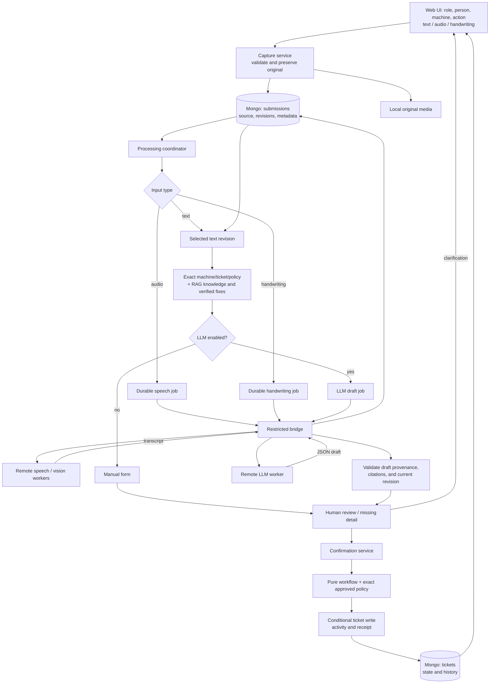

# NIMBUS module guide

This describes the implemented prototype. The larger system specification also contains future features; use this guide and live API schemas for current commands.

The central flow is **source → draft → reviewed action → state transition**. Saving a recording is not a ticket update. A generated draft is not evidence that somebody performed a check.

## 1. Folder map and ownership

```text
src/nimbus/
  config.py              settings; no connections on import
  schemas.py             typed request, draft, evidence, and policy contracts
  workflow.py            pure role/state/verification rules
  database.py            Store interface, MongoStore, MemoryStore
  media.py               original file validation, storage, checksums
  service.py             capture, corrections, reviewed commit, recovery
  knowledge.py           Markdown policies/chunks, lexical/open embedding search
  retrieval.py           exact state + retrieved knowledge + verified history
  processing.py          local input and draft coordinator
  jobs.py                durable jobs and attempt ownership
  http_support.py        consistent HTTP error responses
  api.py                 local application routes and built UI
  bridge.py              restricted remote worker routes
  worker.py              outbound consumer and heartbeat thread
  models.py              explicit open-model registry
  inference/base.py      adapter contract and immutable model revisions
  inference/speech.py    bounded decoding and Whisper transcription
  inference/handwriting.py  Qwen vision transcription
  inference/llm.py        prompt packing, JSON generation, vLLM/fallback
  notebook_setup.py      stdlib bootstrap embedded in first setup cells
  runtime.py             hardware/layout detection and subprocess supervision
  cli.py                 independent commands for each layer
  demo.py                synthetic original-incident replay
web/src/
  App.tsx                board, history, handover, review, confirmation
  api.ts                 HTTP helper and frontend types
  components/InputCapture.tsx  text, microphone/upload, drawing/photo
  components/ActionFields.tsx  forms from backend action metadata
knowledge/               approved organization notes and demo policies
examples/                inspectable CLI source/workflow fixtures
notebooks/               standalone media and LLM launchers
requirements/            local snapshot and separate worker profiles
scripts/                 bootstraps, keys, notebook generator, UI smoke
tests/                   isolated unit/integration checks
docs/                    design, module guide, runtime guide, validation
```

The main agent implemented source, UI, notebooks, and tests. The dependency subagent provisioned environments and bootstrap/package material. The user can review core decisions and reconstruct each module through its independent commands.

Generated state stays outside tracked code: `.venv/`, `.tools/`, `.data/`, `web/dist/`, `output/`, and `artifacts/` are ignored. Audio/images stay under `.data/media`; Mongo stores their key, size, MIME type, and SHA-256. Text stays in Mongo. JSON export provides files for inspection without creating another writable source of ticket truth.

## 2. Actual processing flow



Capture saves originals **before** remote processing. The coordinator handles every input type. Text passes through; audio and handwriting become durable normalization jobs. Workers return computation results, and the local coordinator stores and checks them.

## 3. Contracts and pure workflow

`schemas.py` uses Pydantic models. `extra="forbid"` rejects unknown request keys. `Actor` is person ID/name/selected role. `Capture` specifies source type, action, asset, optional ticket/version, shift, and client retry key. Server receipt times and internal IDs come from the application.

`workflow.transition(ticket, action, actor, fields, policy=..., policy_hash=...)` returns a new prospective dictionary. It never writes storage or calls a model. This is the best first file to understand because it explains why an inspection cannot close a fault.

| Action | Roles | Main required facts | Effect |
| --- | --- | --- | --- |
| `report_fault` | Operator | Title, symptom, reported condition | New open fault |
| `record_observation` | All | Observation | Source-linked note |
| `record_inspection` | Supervisor/maintenance | Subject, method, finding, next action | Recorded check; status preserved |
| `start_work` | Supervisor/maintenance | Work intent | In progress; new cycle when needed |
| `record_work` | Supervisor/maintenance | Summary, result, next action | Progress during active work |
| `submit_for_review` | Supervisor/maintenance | Summary, completion time, approved policy ID/version | Under review with pinned checks |
| `submit_verification` | Operator | Current cycle/policy, test time, typed evidence | Close if eligible; failed test returns to work |
| `acknowledge_handover` | All | Reviewed ticket context | Read record; status preserved |
| `reopen` | All | Reason and observation | Closed → open; prior closure retained |

Closing requires every policy check to say `pass`, `fault_present=false`, sufficient cycles/duration, the correct condition, and actual reported evidence. Evidence before the current work completion cannot verify that work. New fault evidence under review blocks closure until another corrective cycle. Policy content must match the stored plan hash.

The backend validates **reported evidence**, not the physical machine. There is no sensor connection. The five-cycle policy applies only to the synthetic demo asset. Real criteria require approved machine procedures.

`version` advances for every ticket write and guards concurrency. `content_revision` advances for substantive changes, but not acknowledgments, so handover can determine whether somebody read the current content.

```powershell
.\.venv\Scripts\python.exe -m nimbus.cli workflow examples\workflow-report.json
.\.venv\Scripts\python.exe -m pytest tests\test_workflow.py -q
```

## 4. Storage and commit recovery

`Store` defines `insert`, `get`, bounded `find`, conditional `replace`, and `ping`. `MongoStore` persists. `MemoryStore` deep-copies isolated records behind a lock for explicit experiments/tests. A Mongo failure is an error, never a silent memory fallback.

One database holds separate collections:

| Collection | Owned state |
| --- | --- |
| `machines` | Asset ID, type, demo flag |
| `submissions` | Actor/source, revisions, draft, processing, confirmation intent/receipt |
| `tickets` | Current state, cycle, plan, closure, embedded activities/acks |
| `observations` | Machine notes that are not fault tickets |
| `jobs` | Logical input, capability, attempt/lease, result/error |
| `workers` | Capability session, model/revision, readiness/heartbeat |
| `knowledge_chunks` | Retrieved/cited approved content snapshots |

Unique indexes protect capture keys, ticket origin IDs, and logical jobs. Guarded writes include expected versions. Mongo atomically replaces **one** document; this standalone development server is not assumed to provide cross-document transactions.

`Service.confirm()` conditionally reserves the reviewed submission. `_commit()` applies pure rules and stores the activity inside the ticket update. `_finalize()` records the receipt on the submission. If the process stops between steps, `reconcile()` finds the embedded activity and restores the receipt rather than applying another action.

Reusing a key with different input is rejected. Stale text/draft/ticket versions are rejected. Reopened tickets keep the previous closure in their event. The UI keeps corrections after a rejected verification and refreshes the processing version; it can recover a receipt after a lost HTTP response.

Activities are embedded for prototype simplicity. An 8 MiB guard stops writes before Mongo's document limit. Collection reads are bounded at 200; pagination, dedicated history storage, and indexes are later scale work.

## 5. Capture, correction, and clarification

`MediaStore.save()` validates bounded images/audio types, strips MIME parameters such as `audio/webm;codecs=opus`, writes original bytes atomically, and computes SHA-256. Resolving a media key stays inside the media directory. Audio decoding/duration is checked by the speech adapter; MIME alone is not proof of valid audio.

`Service.capture()` saves a source, not a ticket action. `revise_text()` appends a human correction and invalidates an old draft without destroying the original. A clarification is another source with a parent submission ID, and cannot independently create another ticket.

With Mongo running, stop at each stage:

```powershell
.\.venv\Scripts\python.exe -m nimbus.cli seed
.\.venv\Scripts\python.exe -m nimbus.cli --output artifacts\capture.json capture examples\report-capture.json --input examples\report.txt
$submission = Get-Content artifacts\capture.json -Raw | ConvertFrom-Json
.\.venv\Scripts\python.exe -m nimbus.cli inspect submissions $submission._id
.\.venv\Scripts\python.exe -m nimbus.cli --output artifacts\draft.json process --submission-id $submission._id
```

The first record says `saved`; processing returns `ready_for_review`. This example disables AI and includes manual fields. There is still no ticket until confirmation. To explicitly review and commit:

```powershell
$draft = Get-Content artifacts\draft.json -Raw | ConvertFrom-Json
$review = @{
  operation_id = [guid]::NewGuid().ToString()
  draft_revision = $draft.draft_revision
  text_revision = $draft.selected_text_revision
  expected_processing_version = $draft.processing_version
  expected_ticket_version = $null
  reviewed_by = $draft.actor
  fields = $draft.draft.fields
}
$review | ConvertTo-Json -Depth 15 | Set-Content artifacts\reviewed.json -Encoding utf8
.\.venv\Scripts\python.exe -m nimbus.cli confirm $draft._id artifacts\reviewed.json
```

Read the JSON before confirming. The example's fixed capture key makes repetition idempotent; change it for another report. For media, change `source_type` and use `--input note.wav` or `--input note.png`, with `--content-type` if needed. Normalization needs a matching worker or a human transcript correction through UI/API.

## 6. Knowledge and RAG

`Knowledge.sources()` reads Markdown front matter. IDs must be unique/nonempty; invalid YAML fails clearly. `policy()` validates the full catalog before selecting an authority and returns a typed policy and content hash. `chunks()` excludes draft/revoked sources and preserves IDs, paths, and hashes.

`search()` initially ranks word overlap within matching machine/general documents. This is a retrieval baseline, not semantic intelligence. Optional `OpenEncoder` uses Qwen embeddings and cosine similarity, with an immutable model SHA. It loads lazily; default retrieval needs no torch. Document embeddings are recomputed for each retrieval, not maintained as a scalable vector index yet.

`Retriever.context()` combines:

1. Exact machine and a bounded current-ticket snapshot, loaded by ID.
2. Exact applicable approved policies, loaded through the policy contract.
3. Relevant Markdown chunks and verified closed fixes for this machine, with cited IDs/scores.

Similarity search finds context; it does not decide current ticket state or authorize closure. A past fix does not authorize skipping this ticket's checks. The coordinator persists the draft context, and rejects unknown generated fields, nonexistent evidence excerpts, and invented citation IDs. These checks do not prove every interpretation is correct; human review remains required.

```powershell
.\.venv\Scripts\python.exe -m nimbus.cli retrieve "vibration handover verification"
.\.venv\Scripts\python.exe -m pytest tests\test_knowledge.py tests\test_processing.py -q
```

Optional `retrieve ... --embedding` needs the embedding extra and downloads weights. Source-authoritative policy matching remains exact even when embedding search is selected.

## 7. Coordinator and job queue

`Coordinator.process(id)` advances one source. `run_once()` scans bounded pending records, reaps leases, and recovers commits. The API runs it in a background loop; CLI processing works without an HTTP server.

| Processing status | Meaning / next action |
| --- | --- |
| `saved` | Original accepted; coordinator can process |
| `awaiting_normalization` | Speech/handwriting result pending |
| `needs_transcription` | Normalization failed; enter reviewed correction |
| `awaiting_draft` | LLM job pending |
| `awaiting_clarification` | Attached clarification needs normalization |
| `needs_clarification` | Draft exists; required facts/evidence missing |
| `ready_for_review` | Review fields; still not committed |
| `committing` | Frozen action reserved; recovery can finish |
| `confirmed` | Durable action accepted with receipt |
| `attached` | Clarification attached to its parent |
| `needs_attention` | Inspect per-record processing error |

`NIMBUS_INFERENCE_ENABLED` controls **LLM drafting**. Audio/image inputs still queue normalization. **Use manual form** disables AI for that submission; it does not turn an unread image into text. Enter a human correction when necessary.

Logical LLM input includes source revision and context. New facts create different jobs, so a late old result cannot replace the current draft. Repeated pending polls do not keep increasing draft revisions.

```powershell
.\.venv\Scripts\python.exe -m nimbus.cli process --once
.\.venv\Scripts\python.exe -m nimbus.cli process --submission-id SUBMISSION_ID
.\.venv\Scripts\python.exe -m nimbus.cli process
.\.venv\Scripts\python.exe -m pytest tests\test_jobs.py tests\test_worker.py -q
```

The API already owns a coordinator loop. Extra loops are useful for debugging but this is not a tuned multi-replica scheduler.

`JobQueue.claim()` gives one worker a lease/random attempt token; Mongo stores the hash. Workers register ready after actual adapter loading/execution checks. Heartbeats extend ownership up to the runtime deadline. Expired jobs retry within the configured limit. Late attempts cannot change a newly claimed job; identical accepted results can be replayed. A heartbeat/result race rechecks ownership before a bounded conditional retry.

## 8. HTTP boundaries and APIs

```powershell
.\.venv\Scripts\python.exe -m nimbus.cli api --port 8000
.\.venv\Scripts\python.exe -m nimbus.cli bridge --port 8001
```

Both processes must share the same Mongo URI/database, knowledge path, and media path. Separate memory instances cannot share jobs. The core accepts staff actions; the bridge accepts scoped computation. Neither provides arbitrary Mongo writes.

| Core endpoint | Purpose |
| --- | --- |
| `GET /api/health`, `/api/forms`, `/api/machines`, `/api/models` | Diagnostics and UI contracts |
| `POST /api/demo/seed` | Synthetic asset |
| `POST /api/submissions` | Multipart `capture` JSON plus `text` or `file` |
| `GET /api/submissions`, `/{id}`, `/{id}/source` | Raw source/processing inspection |
| `POST /api/submissions/{id}/process` | Advance one source |
| `POST /api/submissions/{id}/text-revisions` | Append human correction |
| `POST /api/submissions/{id}/manual-form` | Disable AI for this draft |
| `POST /api/submissions/{id}/confirm` | Reviewed, versioned action |
| `GET /api/tickets`, `/{id}`, `/{id}/export` | Board/history/JSON export |
| `GET /api/observations`, `/api/handover` | Notes and outstanding faults |
| `GET /api/knowledge/search` | Explicit lexical search |
| `GET /api/workers`, `/api/jobs` | Local diagnostics; job credentials omitted |

There is no `PATCH status=closed` shortcut. Domain errors use `{"error":{"code":"...","message":"...","details":{...}}}`. Mongo unavailability is 503; stale state is 409; invalid evidence generally is 422. Full schemas are in local `/docs`.

| Bridge endpoint | Purpose |
| --- | --- |
| `GET /bridge/health` | Scoped connectivity check |
| `POST /bridge/workers/register` | Allowed capability/model/revision/readiness |
| `POST /bridge/workers/{id}/heartbeat` | Session health |
| `POST /bridge/jobs/claim` | Worker claims one matching job |
| `GET /bridge/jobs/{id}/input`, `/media` | Only current attempt's input |
| `POST /bridge/jobs/{id}/heartbeat` | Extend ownership |
| `POST /bridge/jobs/{id}/result` | Validated, replayable output |
| `POST /bridge/jobs/{id}/fail` | Bounded failure/retry |

All bridge routes require the capability bearer key. Attempt routes additionally require `X-Attempt-Token`, with worker/attempt IDs where defined. There are no staff ticket routes or bridge API docs. Workers have no Mongo credentials. A speech key cannot register an LLM. Remote URLs must be HTTPS origins without embedded credentials; local loopback HTTP is allowed. Returned download/result paths must retain that origin.

## 9. Model and runtime boundaries

All model imports are lazy. Adapters provide `smoke()` and `run(payload, media_path)`. A smoke fixture checks execution, not factory accuracy.

- Speech: bounded frame decoding to mono 16 kHz; reject empty/overlong recordings; faster-whisper transcription.
- Handwriting: process a copied/rotated/resized image; Qwen transcribes; original remains untouched.
- LLM: pack using the actual tokenizer, preserve current source and policy, remove lower-priority retrieved context as needed, reserve output tokens, parse/validate JSON. Private vLLM structured generation or Transformers fallback.
- Runtime: detect hardware; separate media GPUs through `CUDA_VISIBLE_DEVICES`; one LLM replica uses two pipeline stages and one tensor-parallel rank. CPU/P100 Transformers uses one device. TPU has no implemented adapter and fails explicitly.
- Notebook setup: stdlib helpers are embedded because a clone does not exist yet. Only these helpers are copied into cells; model source remains in Git. Reset requires an owned directory marker; results stay outside the clone.
- Runtime supervision: a manifest is saved before model resolution; subprocesses have separate logs; stopping cleans up owned children. Even revision/download failures retain run metadata.

See [model/runtime setup](MODELS_AND_RUNTIME.md) for infer/worker/notebook commands and networking.

## 10. Debug from the failing layer

| Symptom | Inspect | Establish |
| --- | --- | --- |
| App fails to start | `doctor`, Mongo process/URI | Correct interpreter and reachable DB |
| Capture rejected | Metadata, MIME/size, browser error | Correct asset/role/source and valid input |
| Media pending | Jobs/workers and runtime logs | Matching capability ready and connected |
| Transcript unreadable | Original source and one-input inference | Decoding/model failure; human correction |
| Draft pending | LLM/vLLM log | Readiness, lease, JSON support, token budget |
| Generated field rejected | Context/revisions/error | Validation caught issue; manual path available |
| Confirm 409 | Latest draft/ticket versions | Review newer facts; keep concurrency guard |
| Verify 422 | Policy and submitted checks | Current cycle/time/condition/count/results |
| Duplicate suspected | Origin ID, operation key, embedded event | Receipt replay rather than second action |
| Notebook stale | First-cell SHA and `run.json` | Exact fetched ref used |
| Results lost | Results path/archive/saved outputs | Outside clone and persisted before reset |

The UI exposes **Inspect processing record**. Ticket export links every accepted source. Read these before changing rules or guessing at model behavior.

Start a code review with `schemas.py` → `workflow.py` → `service.py` → `processing.py` → `jobs.py` → `worker.py`. Be able to explain: Who owns status? What did the person submit? Which revision did they review? Which cycle was tested? Which attempt owns a model result? How does an interrupted commit recover without another action?

Agentic behavior is a bounded retrieve/draft/question/review pipeline. No MCP server or general autonomous agent framework is required or implemented. A future MCP wrapper should expose narrow service operations, not arbitrary database commands.
